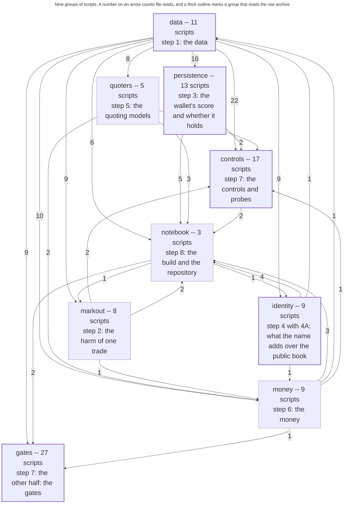

# The pipeline, group by group

GENERATED FILE. Producer `build_diagram.py`, written 2026-10-21T18:10:45Z. Every box, arrow and caption below is read from `build.graph()` and from the `GROUPS` table in `run/_groups.py`; nothing here is typed by hand, and an edit to this file is overwritten by the next run of the producer.

Each box is one group of the pipeline and carries the step it is the code of, in the words run/_groups.py declares. The number on an arrow is how many times a file written by the group at the tail is read by a script of the group at the head. A thick border marks a group that walks the raw archive, which is what makes a recompute cost hours rather than seconds. The question each group answers is one sentence long and is printed in the table below rather than inside a box: nine boxes of three lines each shrink the type on a report page to under eight points, and the whole point of a picture is that it can be read.

The same flowchart is committed as a picture, `pipeline_diagram.png`, for the report to place. It is rendered from the block below by mermaid-cli, which is a Node program and therefore not something `requirements.txt` can install, so the picture is a file in this repository rather than a build step. `build_diagram.py --png` refreshes it where mermaid-cli is installed and says so where it is not, and `--check` reports whether the committed picture is still what this flowchart draws.

The picture is drawn to be placed across the whole text column of the report, which the template sets at 140 mm. At that width the type in the boxes measured 8.40 pt on 2026-08-08 against body text of 11 pt, and the figure stands 196 mm tall, which leaves 51 mm of the page under it for the caption. Placing it narrower shrinks the type in proportion and is what the layout was chosen against: `build_diagram.py --measure` renders the flowchart and reads those three numbers back off it rather than restating them.

## The groups

| group | step | entry point | scripts | of them walk the archive | the question it answers |
|---|---|---|---|---|---|
| `data` | 1, the data | `run/data.py` | 11 | 7 | what was parsed out of the public archive, over which windows and coins, and does the parse still reproduce |
| `markout` | 2, the harm of one trade | `run/markout.py` | 8 | 0 | how large the harm to the maker who filled a trade is, and how it is shaped -- over the horizon, over the trade size, over the taker's inventory and over the side |
| `persistence` | 3, the wallet's score and whether it holds | `run/persistence.py` | 13 | 3 | whether the harm is a stable trait of the wallet rather than a property of one window: does a wallet scored in one window keep its rank in a disjoint later one, and how much of the cross-sectional variance is a per-wallet component at all |
| `identity` | 4 with 4A, what the name adds over the public book | `run/identity.py` | 9 | 1 | whether a maker who sees only public information -- the trade tape, and then the full order book -- could have recovered what the counterparty's identity gives, and whether the identity term survives the controls that would explain it away |
| `quoters` | 5, the quoting models | `run/quoters.py` | 5 | 0 | what the standard quoting models do on this fill set, and what the counterparty-resolved term changes about the quote they set |
| `money` | 6, the money | `run/money.py` | 9 | 0 | what the harm is worth in currency: how large the maker's loss to adverse selection is over the window, where it is concentrated, and what a policy that acts on the counterparty changes about it |
| `controls` | 7, the controls and probes | `run/controls.py` | 17 | 1 | whether each result is explained by something other than what it is claimed to be explained by |
| `notebook` | 8, the build and the repository | `run/notebook.py` | 3 | 0 | what the reproducibility notebook downloads and what it asserts against, so that a reader with no archive access and no repository beside them recomputes the reported numbers and is told, per number, whether it came out the same |
| `gates` | 7, the other half: the gates | `run/gates.py` | 27 | 6 | whether the raw parse is right byte for byte, and whether the repository still holds against its own rules |

## Every arrow, and what crosses it

`read edges` counts one for each pair of an artifact and a script that reads it. `distinct artifacts` counts the files themselves, so a file read by three scripts of one group is three read edges and one artifact. The two are different questions and are printed apart on purpose.

| from | to | read edges | distinct artifacts |
|---|---|---|---|
| `data` | `controls` | 22 | 7 |
| `data` | `persistence` | 16 | 6 |
| `data` | `money` | 10 | 3 |
| `data` | `gates` | 9 | 4 |
| `data` | `identity` | 9 | 3 |
| `data` | `markout` | 9 | 4 |
| `data` | `quoters` | 8 | 3 |
| `data` | `notebook` | 6 | 5 |
| `persistence` | `notebook` | 5 | 5 |
| `identity` | `notebook` | 4 | 4 |
| `money` | `notebook` | 3 | 3 |
| `quoters` | `notebook` | 3 | 3 |
| `controls` | `notebook` | 2 | 2 |
| `markout` | `controls` | 2 | 2 |
| `markout` | `notebook` | 2 | 2 |
| `notebook` | `gates` | 2 | 1 |
| `persistence` | `controls` | 2 | 2 |
| `quoters` | `money` | 2 | 2 |
| `identity` | `data` | 1 | 1 |
| `identity` | `money` | 1 | 1 |
| `markout` | `money` | 1 | 1 |
| `money` | `controls` | 1 | 1 |
| `money` | `data` | 1 | 1 |
| `money` | `gates` | 1 | 1 |
| `notebook` | `identity` | 1 | 1 |
| `notebook` | `markout` | 1 | 1 |
| `quoters` | `controls` | 1 | 1 |

## The count, and the predicate that took it

Population: every read edge of the dependency graph, that is every pair of a script and an artifact it reads whose producer this tree holds. Predicate: the producer's group against the consumer's group, under the membership typed in `run/_groups.py`. The three buckets are exhaustive and disjoint, so they sum to the total, and `--check` fails when they do not.

| quantity | value |
|---|---|
| scripts scanned | 126 |
| producer nodes | 105 |
| artifacts produced | 144 |
| groups declared | 9 |
| read edges, total | 146 |
| of them inside one group | 21 |
| of them across two groups | 125 |
| of them touching a node no group claims | 0 |
| arrows drawn between groups | 27 |
| distinct artifacts crossing a boundary | 32 |
| cycles build.py reports | 0 |

## What is not on the picture, and why

3 producer nodes belong to no group, so no box holds them and the edges touching them are counted in their own bucket above rather than drawn. They are named here rather than dropped, because a picture that quietly omits part of the pipeline is worse than one that says what it omits. `run/<group>.py --census` reports the same list.

- `build_diagram.py`
- `data_register.py`
- `prose_assemble.py`
